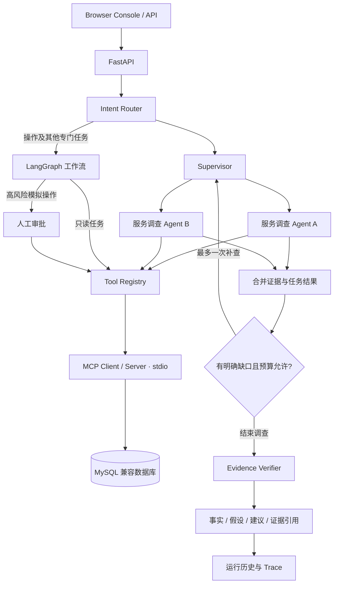

# WorkPilot Agent

面向研发故障排查的多 Agent 应用。用户描述一个或多个服务的故障后，Supervisor 按服务分派独立调查任务，收集日志、工单和知识库证据，再由核验 Agent 检查关键结论，输出带引用的分析与排查建议。

项目包含 FastAPI API、MCP 查询服务、SQL Guard、人工审批和浏览器 Agent Trace Console。默认页面使用多 Agent 入口；运维操作目前仅支持模拟执行。

## 功能概览

- **按服务分工**：最多识别 3 个服务，每个调查 Agent 拥有独立任务状态、数据库 Session 和证据快照；默认最多同时运行 2 个调查分支。
- **自主调查**：调查 Agent 根据已有证据选择后续只读工具，区分事实、假设、建议和证据缺口。
- **局部失败隔离**：查询失败时记录错误，继续独立步骤和其他服务的调查。空结果表示未检索到相关记录。
- **有限重试与补查**：可明确识别的临时只读连接错误最多额外重试一次；初始日志窗口为空时为 Supervisor 保留一次扩大时间窗查询的额度。
- **独立结论核验**：Verifier 对照原始记录审查每条结论，标记 supported、unverified 或 unsupported。核验失败时仍展示原始记录与后续检查。
- **工具与审批**：Tool Registry 校验工具输入输出、权限和风险，并记录审计。重启等操作请求进入已有的模拟操作审批流程。
- **可观测性**：Console 展示任务分派、各服务状态、工具与模型调用、证据来源、核验意见及最终回答；运行历史和 Trace 持久化到数据库。
- **查询能力**：BM25 知识检索、经 SQLGlot AST 校验的只读 Text2SQL，以及带 API Key 的日志/知识导入和告警入口。
- **调查协作（P4）**：告警进入持久任务队列；团队认领、反馈、备注和交接历史独立保存。执行完成不代表人工确认根因。启动与验收见 [P4 运行说明](docs/P4-runbook.md)。

## 架构与工作流



多 Agent 调查使用有界 Supervisor 调度；既有专门任务、Single Agent 基线和审批流程继续使用 LangGraph。日志、工单、知识查询通过官方 MCP Python SDK 的本地 stdio Client/Server 执行。

分支之间传递结构化任务和结果，通过全局唯一 evidence_id 关联来源 Agent、工具、参数、尝试次数与原始记录。调查分支可并发执行，但当前共享 MCP Client 通过队列处理请求，不能将其描述为所有数据库工具均端到端并行。

### 默认调查预算

| 项目 | 当前上限 |
| --- | --- |
| 服务数 / 同时执行的调查分支 | 3 / 2 |
| 全局工具尝试次数 | 9 |
| 每服务工具尝试次数，含重试与补查 | 3 |
| Supervisor 补查调度 | 每次运行最多 1 次 |
| 可识别临时只读连接错误重试 | 原步骤最多额外 1 次 |
| 诊断模型调用 | 3 × 服务数 + 1 |
| 调查运行时间预算 | 180 秒，按调度检查；不保证中断已发出的远端请求 |

诊断模型请求当前设置为 30 秒超时、SDK 自动重试 0 次。实验额外配置了输入长度、输出长度和保守 Token 预留上限，详见对应 manifest；这些实验限制不等同于所有在线接口的全局 Token 配额。旧 Single Agent 的最多 5 步计划仅用于既有工作流及基线。

## 技术栈

| 层 | 实现 |
| --- | --- |
| API / 配置 | Python 3.11、FastAPI、Pydantic 2、pydantic-settings |
| Agent / 审批 | Supervisor 有界调度、独立调查 Agent、Verifier、LangGraph 工作流 |
| 数据库 | SQLAlchemy 2、PyMySQL、MySQL 8+ 兼容数据库 |
| 工具 / SQL | 自定义 Tool Registry、Pydantic 工具契约、SQLGlot SQL Guard |
| 检索 / 协议 | BM25、官方 MCP Python SDK、stdio |
| 模型 | 统一 LLMService，支持 OpenAI-compatible 接口 |
| 前端 | 原生 HTML、CSS、JavaScript；FastAPI 同源托管 |

### 数据存储

| 数据表 | 用途 |
| --- | --- |
| tickets / error_logs / knowledge_docs | 工单、日志和知识库 |
| agent_runs | 运行状态、输入与最终回答 |
| tool_call_logs / agent_trace_events | 工具审计、执行和模型调用轨迹 |
| agent_approval_checkpoints | 等待审批的数据库快照及领取状态 |

## 本地启动

需要 Python 3.11、既有 Conda 环境 workpilot 和一个可连接的 MySQL 兼容数据库。

### 1. 安装依赖与配置

PowerShell：

```powershell
Set-Location "D:\WorkPilot Agent\workpilot-agent"
conda activate workpilot
python -m pip install -r requirements.txt

# 首次配置时执行；已有 .env 则保留原配置
if (-not (Test-Path .env)) { Copy-Item .env.example .env }
```

在数据库中创建项目库，例如：

```sql
CREATE DATABASE workpilot_agent
  CHARACTER SET utf8mb4 COLLATE utf8mb4_unicode_ci;
```

编辑根目录 .env：

| 配置 | 说明 |
| --- | --- |
| MYSQL_HOST / MYSQL_PORT / MYSQL_USER / MYSQL_PASSWORD / MYSQL_DATABASE | 数据库连接 |
| MYSQL_SSL_CA | 托管数据库需要 TLS 时填写 CA 文件路径 |
| LLM_API_KEY / LLM_MODEL | 启用模型调查和语义核验 |
| LLM_BASE_URL | 自定义 OpenAI-compatible 服务地址 |
| LLM_TIMEOUT / LLM_MAX_RETRIES | 通用网关配置；诊断路径采用上文的专门限制 |
| LLM_ENABLE_THINKING | 服务商支持时控制推理模式 |
| INGESTION_API_KEY | 导入和告警接口密钥，至少 16 个字符 |

没有配置模型时使用受限回退能力，Text2SQL 工具不会注册，不能视为真实模型多 Agent 诊断演示。

### 2. 初始化并启动

```powershell
python -m scripts.init_db
python -m scripts.seed_data
python -m uvicorn backend.main:app --reload --host 127.0.0.1 --port 8000
```

seed_data 导入带 [DEMO] 标记的合成工单、日志和知识记录，可重复运行。应用启动时会连接本地 MCP 子进程，并检查已保存的审批状态。

- Console：<http://127.0.0.1:8000/console/>
- API 文档：<http://127.0.0.1:8000/docs>
- 健康检查：<http://127.0.0.1:8000/health>

若模型连接受本地代理影响，可在当前 PowerShell 会话中将实际模型域名加入 NO_PROXY；例如使用 ModelScope 时：

```powershell
$env:NO_PROXY = "api-inference.modelscope.cn,127.0.0.1,localhost"
```

该设置用于模型网络连接，不会恢复服务商额度。接口返回 429 时需结合服务商消息判断限流或余额不足。

## 页面使用

### 双服务故障调查

```text
分析 order-service 和 inventory-service 最近的超时故障，
分别核对日志和工单，判断是否存在关联，
给出可能原因、排查建议、证据引用及仍不确定的事项。
```

在 Console 点击 Run Agent：

1. 查看 Agent Trace 中的任务分派、调查决策和核验过程。
2. 在 Plan 查看各服务任务、状态和预算。
3. 在 Evidence 核对原始记录，在 Final Answer 查看结论和建议。
4. 从最近运行中重新打开已完成任务，可复盘演示而无需再次调用模型。

### 模拟重启与审批

```text
重启 order-service 和 inventory-service
```

该请求识别为 operation，由 Supervisor 交给审批工作流。页面提示当前仅支持模拟操作，在批准前不调用操作工具；批准后返回“已模拟执行”。系统不会真实重启服务。拒绝或取消则不执行该模拟工具。

### 知识与数据查询

```text
搜索 Redis 超时排查的知识库文档
统计各服务的工单数量
```

这些任务使用专门工作流。Text2SQL 经 SQL Guard 检查后才能执行：只允许受限表、列和函数范围内的单条 MySQL SELECT，结果最多 100 行，OFFSET 最大 10000。

## API

| 方法 | 路径 | 用途 |
| --- | --- | --- |
| GET | /health | 数据库连通性 |
| POST | /agent/runs | 默认入口：故障调查分派至 Multi，其他任务交给专门工作流 |
| POST | /agent/runs/async | 创建异步任务，返回 run_id 与 events_url |
| GET | /agent/runs/{run_id}/events | SSE 进度事件 |
| POST | /agent/runs/{run_id}/approval | approve / reject / cancel |
| GET | /agent/runs | 分页查询历史 |
| GET | /agent/runs/{run_id} | 运行详情 |
| GET | /agent/runs/{run_id}/trace | 持久化 Trace |
| GET | /tickets、/logs、/knowledge | 业务数据读取 |
| POST | /ingestion/logs、/ingestion/knowledge | 受 API Key 保护的批量导入 |
| POST | /alerts/incidents | API Key + 登录会话 + 团队服务授权；返回 202，告警入 P3 持久队列 |
| GET / PATCH | /agent/runs/{run_id}/collaboration | 查看 / 更新负责人、人工处理状态、结果反馈和备注 |
| GET | /investigations/summary | 当前团队可访问任务按声明来源、执行状态、人工反馈分组统计 |

导入与告警接口使用 X-Ingestion-Key。同步 /agent/runs 的 X-WorkPilot-Comparison-Mode: single 请求头仅用于历史对照；Console 默认不提供单 / 多 Agent 切换。

P4 告警还要求有效登录 Cookie 和 `X-WorkPilot-Team-Id`，并启用
`P3_DURABLE_ENABLED=true`、完成 P1–P4 迁移、启动独立 Worker。该入口不再同步
返回完整报告；调用者使用返回的 `run_id` / `events_url` 读取结果。同团队的
`source + event_id` 相同且内容相同返回原任务，不同内容返回 409。
`source_kind` 是提交方的来源声明；合成、本地测试、外部和未标记数据分组统计，
这些计数及人工反馈均不是根因准确率。详情见 P4 运行说明。

## 验证与实验

### 本地验证

```powershell
# 路由、模拟操作审批与多 Agent 调度
python -m pytest tests/test_router.py tests/test_agent.py tests/test_multi_agent.py -q

# 诊断、评分与实验适配
python -m pytest tests/test_diagnostic_agents.py tests/test_model_comparison.py tests/test_model_scoring.py tests/test_dataset_experiment.py -q
```

重启请求修复后的第一组验证为 48 项通过。相关验证使用受控测试数据；不等同于对当前远端数据库和模型接口的在线验收。

### 18 场景对照实验

2026-10-18 使用 Qwen/Qwen3.5-35B-A3B，对增强 Single 和 Multi 各运行 18 次，每场景每组一次。场景覆盖配置根因、跨服务依赖、冲突证据、空结果、工具失败、重试和补查。

两组使用相同合成记录与预算。调查与独立评分调用真实模型；工具和数据库 Session 使用 fixture。两组共享的相同工具请求返回内容一致，36 次运行均未超出实验预算。

| 主实验指标 | 增强 Single | Multi |
| --- | ---: | ---: |
| 执行流程完成 | 18/18 | 18/18 |
| 核验流程完成 | 14/18 | 14/18 |
| 平均耗时 | 27.6 秒 | 22.1 秒 |
| 调查模型调用数 | 80 | 87 |
| 调查 Token 合计 | 175,860 | 185,483 |
| 自动严格验收通过，已评分 16 场景 | 5/16 | 1/16 |

两个场景的评分调用失败；评分另消耗 80,650 Token，不包含在调查 Token 中。执行 completed 或核验 completed 均不代表业务答案正确。

自动评分已发现误判和对后续检查建议的统计遗漏，上表不是人工准确率。此次观察到 Multi 平均耗时更短、调查 Token 更多，但没有证明其整体诊断质量更优。样例已经参与调试，结果属于固定合成任务的探索复测，不是未见留出集或生产准确率。

主实验后修复了过时缺口累计和补查预算被提前耗尽的问题。单独复验中，两组都在每服务 3 次工具额度内扩大到 24 小时并取回日志；Multi 给出 worker_slots=0 的受控原因及恢复到 10 的建议。该复验的自动评分解析失败，另保留 Codex 复核记录，不替换主实验分数。

- [冻结数据集](eval/datasets/w4_v1.json)
- [主实验汇总](eval/results/dataset_experiment/20261018T142003Z/audit_summary.json)
- [评分分歧与已发现问题](eval/results/dataset_experiment/20261018T142003Z/review_notes.json)
- [补查复验汇总](eval/results/dataset_experiment/20261018T143910Z/audit_summary.json)
- [补查复核记录](eval/results/dataset_experiment/20261018T143910Z/assistant_review.json)

以下命令会消耗模型额度，并生成新的结果目录：

```powershell
# 全量：18 场景，每组各一次
python -m eval.run_dataset_experiment --online

# 只运行一个指定场景，两组各一次
python -m eval.run_dataset_experiment --online --case followup_finds_logs
```

历史 Single Agent 实验单独保留在 [Phase 22 结果](eval/results/phase22-final-closeout-2026-09-25.json)，不与本轮不同预算、不同评分口径直接混算。当前尚未完成完整消融实验及每场景三次重复。

## 目录导航

```text
backend/
  agent/          路由、规划、风险判断、诊断与核验
  services/       Supervisor 调度、服务调查、专门任务、审批与历史
  tools/          Tool Registry 与受控工具
  mcp/            stdio Client / Server
  security/       SQL Guard
  routers/        HTTP / SSE 接口
  schemas/        请求、工具、Agent 任务和结果契约
  models/         SQLAlchemy 数据模型
frontend/         Agent Trace Console
scripts/          数据库初始化与演示数据
eval/             数据集、对照运行、评分及结果
tests/            自动化验证
```

## 部署与使用范围

提供 [Render 部署模板](render.yaml)，需要单独配置 MySQL 兼容数据库、TLS CA、模型和导入密钥。模板在启动阶段执行初始化与演示数据装载。当前 BackgroundTasks、SSE Broker 和 LangGraph InMemorySaver 使用进程内状态，适合单实例演示；多副本部署需要另外设计任务队列与事件共享。

工具审计、Trace 和审批快照持久化到数据库。等待审批的专门任务可从数据库快照继续；已领取但执行结果不明的审批按失败处理，不自动重放。多 Agent 调查不提供完整的跨进程中断恢复。

普通读取和 Agent 接口尚无用户认证、租户隔离及请求限流。当前版本用于授权的开发、实验和演示环境；不执行真实生产操作。.env、真实凭据与敏感日志不应提交到仓库。

后续可按实际需求推进评分人工复核、对照消融和部署演示，现有实验结果及失败记录均保留。
